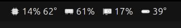

# Topbar Monitor

A tiny GNOME Shell extension that shows CPU, RAM, GPU and temperatures in the top bar.



*CPU 14% at 62° · RAM 61% · GPU 17% · NVMe SSD 39°*

- **Light**: runs inside `gnome-shell`, reads `/proc` and `/sys` every 2 s. It starts no extra process, except one `nvidia-smi` on NVIDIA machines.
- **No root, no dependencies.** About 300 lines of JavaScript.
- Click the bar to open **Resources**, **GNOME System Monitor** or **Mission Center**, whichever is installed.

[Tiếng Việt ↓](#tiếng-việt)

---

## Requirements

| | Supported |
|---|---|
| Desktop | **GNOME Shell 45 – 50** (Wayland or X11) |
| Distros | Ubuntu 24.04+, Fedora 39+, Debian 13, Arch, openSUSE Tumbleweed… |
| GPU | Intel (i915, xe), AMD (amdgpu), NVIDIA (proprietary driver with `nvidia-smi`) |

Not supported: GNOME 44 or older (Ubuntu 22.04, Debian 12), KDE, XFCE, Cinnamon, MATE, i3/Sway/Hyprland.

Check your GNOME version:

```bash
gnome-shell --version
```

## Installation

### Option 1: release zip (recommended)

**1. Download the latest release.**

```bash
wget https://github.com/daoduong007/topbar-monitor/releases/latest/download/topbar-monitor@daoduong007.shell-extension.zip
```

You can also download it from the [Releases page](https://github.com/daoduong007/topbar-monitor/releases/latest).

**2. Install it.**

```bash
gnome-extensions install --force topbar-monitor@daoduong007.shell-extension.zip
```

This copies the files to `~/.local/share/gnome-shell/extensions/topbar-monitor@daoduong007/`. No `sudo` needed.

**3. Make sure user extensions aren't blocked.**

```bash
gsettings set org.gnome.shell disable-user-extensions false
```

Ubuntu sometimes sets this key to `true`, for example after GNOME Shell crashes. That silently blocks every extension you install yourself.

**4. Log out and log back in.**

On **Wayland** (the default on Ubuntu and Fedora), GNOME only finds new extensions at login. On an X11 session (GNOME 48 and older only) you can press <kbd>Alt</kbd>+<kbd>F2</kbd>, type `r`, and press <kbd>Enter</kbd> instead.

**5. Enable the extension.**

```bash
gnome-extensions enable topbar-monitor@daoduong007
```

You can also turn it on in the **Extensions** app, or in **Extension Manager**. The stats show up at once in the right part of the top bar.

**6. Check it.**

```bash
gnome-extensions info topbar-monitor@daoduong007
```

You should see `Enabled: Yes` and `State: ACTIVE`.

### Option 2: from source

```bash
git clone https://github.com/daoduong007/topbar-monitor.git
cd topbar-monitor
./install.sh
```

`install.sh` copies the files, turns off `disable-user-extensions` if it's on, and enables the extension. Then **log out and back in**.

## Updating

Install the new zip, or run `git pull && ./install.sh`, then log out and back in. GNOME keeps the old code loaded until you do.

## Uninstalling

```bash
gnome-extensions uninstall topbar-monitor@daoduong007
```

Or run `make uninstall` from the source folder.

## Troubleshooting

| Problem | Fix |
|---|---|
| Nothing in the top bar after login | 1. `gsettings get org.gnome.shell disable-user-extensions` must print `false`. 2. `gnome-extensions info topbar-monitor@daoduong007` should show `Enabled: Yes`; if not, enable it. 3. Did you log out and in *after* installing? |
| `Extension "topbar-monitor@daoduong007" doesn't exist` | GNOME hasn't scanned it yet: log out and back in, then enable it. |
| State `OUT OF DATE` | Your GNOME is older than 45 or newer than 50. For a newer GNOME, add its version to `shell-version` in `metadata.json` and reinstall. |
| State `ERROR` | Look at the log: `journalctl --user -b \| grep -i topbar` |
| GPU item missing | No supported GPU counter was found, e.g. NVIDIA without `nvidia-smi`, or a VM. |
| NVIDIA shows `off` | Normal on hybrid laptops: the dGPU is suspended to save power. |
| NVIDIA shows `n/a` | `nvidia-smi` failed 5 times in a row. Check that `nvidia-smi` works in a terminal. |

## What it shows

| Item | Source |
|---|---|
| CPU % | `/proc/stat`, change since the previous read |
| CPU temp | hwmon `coretemp` / `k10temp` / `zenpower` / `cpu_thermal` |
| RAM % | `/proc/meminfo`, `1 − MemAvailable / MemTotal` |
| GPU %: Intel i915 | RC6 idle time, `gt/gt0/rc6_residency_ms` (estimate) |
| GPU %: Intel xe | `device/tile0/gt0/gtidle/idle_residency_ms` (estimate) |
| GPU % + VRAM: AMD | `gpu_busy_percent`, `mem_info_vram_*` |
| GPU % + temp + VRAM: NVIDIA | one long-running `nvidia-smi --loop` |
| Disk temp | hwmon `nvme` / `drivetemp` |

An item is hidden when its sensor isn't present.

### NVIDIA on hybrid laptops

A running `nvidia-smi` keeps the dGPU awake. When the GPU uses runtime power management (`power/control = auto`), the extension runs `nvidia-smi` for 30 s, then pauses so the GPU can suspend. While the GPU is suspended the extension shows `off` and starts nothing. It starts `nvidia-smi` again only after something else wakes the GPU. On desktops the loop runs all the time.

## Development

```bash
make zip      # build topbar-monitor@daoduong007.shell-extension.zip
make install  # pack and install for the current user
make test     # test the NVIDIA logic with a fake sysfs tree and a fake nvidia-smi
```

To change the refresh rate, edit `INTERVAL_S` in `extension.js`.

---

## Tiếng Việt

Extension GNOME hiển thị CPU / RAM / GPU / nhiệt độ ở góc phải thanh trên cùng (xem ảnh ở đầu trang). Nó chạy ngay trong GNOME, chỉ đọc file `/proc` và `/sys`, không cần root và không cài thêm gì.

### Yêu cầu

- **GNOME 45 – 50**: Ubuntu 24.04 trở lên, Fedora 39+, Debian 13, Arch…
- Kiểm tra bằng lệnh `gnome-shell --version`.
- **Không** chạy trên Ubuntu 22.04 trở về trước, KDE, XFCE, Cinnamon (Linux Mint)…

### Cài đặt từng bước

**Bước 1: Tải file cài đặt**

```bash
wget https://github.com/daoduong007/topbar-monitor/releases/latest/download/topbar-monitor@daoduong007.shell-extension.zip
```

**Bước 2: Cài extension**

```bash
gnome-extensions install --force topbar-monitor@daoduong007.shell-extension.zip
```

**Bước 3: Bỏ chặn extension tự cài**

```bash
gsettings set org.gnome.shell disable-user-extensions false
```

Ubuntu đôi khi tự bật tùy chọn chặn này (ví dụ sau khi GNOME bị lỗi). Khi đó mọi extension tự cài đều không chạy, và GNOME không báo gì.

**Bước 4: Đăng xuất rồi đăng nhập lại**

Trên Wayland (mặc định của Ubuntu), GNOME chỉ nhận extension mới khi đăng nhập.

**Bước 5: Bật extension**

```bash
gnome-extensions enable topbar-monitor@daoduong007
```

Các chỉ số sẽ hiện ngay ở góc phải thanh trên cùng.

**Bước 6: Kiểm tra**

```bash
gnome-extensions info topbar-monitor@daoduong007
```

Kết quả phải có `Enabled: Yes` và `State: ACTIVE`.

**Cách khác: cài từ mã nguồn**

```bash
git clone https://github.com/daoduong007/topbar-monitor.git
cd topbar-monitor
./install.sh
```

Script tự làm bước 3 và bước 5. Bạn chỉ cần đăng xuất rồi đăng nhập lại.

### Không thấy hiển thị?

1. Chạy `gsettings get org.gnome.shell disable-user-extensions`. Kết quả phải là `false`.
2. Chạy `gnome-extensions info topbar-monitor@daoduong007`. Nếu thấy `Enabled: No`, chạy lệnh bật ở bước 5.
3. Nếu báo *doesn't exist*: đăng xuất, đăng nhập lại, rồi bật.
4. Xem log lỗi: `journalctl --user -b | grep -i topbar`

### Cập nhật / gỡ cài đặt

- **Cập nhật**: cài file zip mới (hoặc chạy `git pull && ./install.sh`), rồi đăng xuất và đăng nhập lại.
- **Gỡ**: `gnome-extensions uninstall topbar-monitor@daoduong007`

## License

GPL-2.0-or-later
